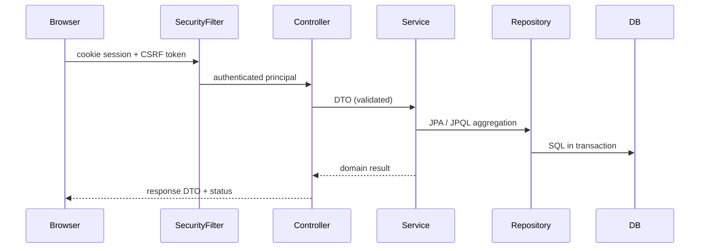
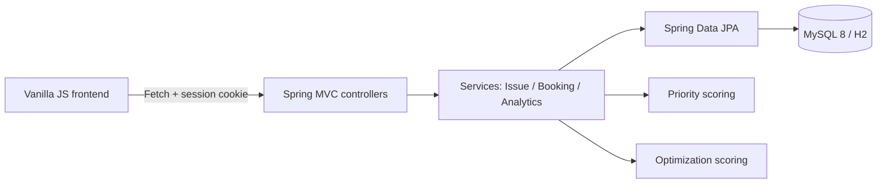

# CampusOS — Architecture

## 1. Style
Modular monolith, layered MVC. One deployable Spring Boot 3 application + static vanilla-JS frontend (no framework). MySQL 8 in production; H2 (MySQL mode) for tests/local fallback so the app runs without Docker.

## 2. Module boundaries (package `com.campusos`)
```
config/     Security, web, Jackson, CORS/CSRF wiring
common/     exception/ (ApiError, @RestControllerAdvice), response/ (PageResponse)
security/   UserDetails adapter, current-user helper
auth/       login/logout/me
user/       User entity, Role enum, repository
issue/      Issue + IssueActivity, workflow, priority service
resource/   Resource catalogue
booking/    Booking lifecycle + concurrency guard
analytics/  Aggregations + optimization simulator
```
Dependency direction: `controller → service → repository → entity`. Controllers never touch repositories. DTOs never expose entities. Modules communicate through services, not repositories of other modules (booking calls resource repository only for the locked row — documented exception for the lock).

## 3. Request lifecycle


## 4. Component diagram


## 5. Authentication architecture
Server-side sessions (`JSESSIONID`, HttpOnly, SameSite=Lax, Secure behind HTTPS), BCrypt password hashing, CSRF via `CookieCsrfTokenRepository.withHttpOnlyFalse()` (SPA-readable token cookie, header `X-XSRF-TOKEN`). Chosen over JWT because same-origin browser app: no token in `localStorage`, instant revocation on logout, CSRF handled by Spring. Login: `POST /api/v1/auth/login` → session; `GET /api/v1/auth/me`; `POST /api/v1/auth/logout`.

## 6. Key decisions
| Decision | Choice | Trade-off |
|---|---|---|
| Booking concurrency | `SELECT … FOR UPDATE` on resource row + overlap check in same tx | Serialises bookings per resource; simple, correct; throughput fine at campus scale. Unique constraint rejected (cannot express interval overlap). |
| Priority | Deterministic rule scoring with explanation | Transparent/auditable vs ML opacity. |
| Time | Store `Instant` (UTC), accept ISO-8601 with offset, display campus zone | Avoids server-TZ bugs. |
| Frontend serving | Spring serves `frontend/` as static resources | One process, one origin, no CORS in dev. |
