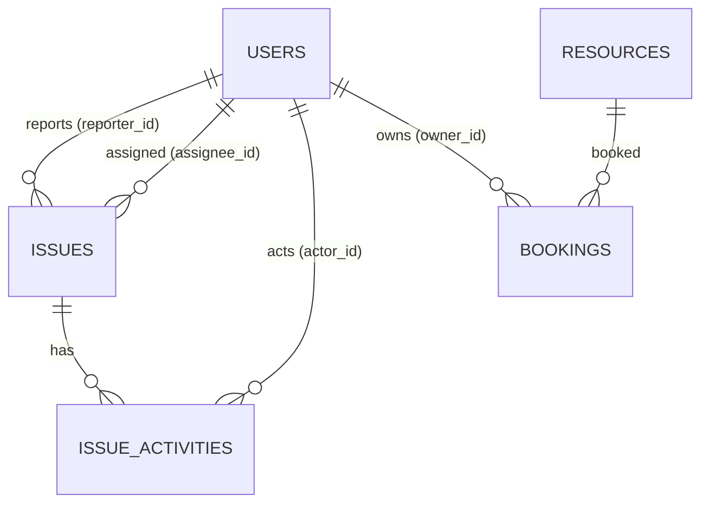

# CampusOS — Database Design

## 1. ER diagram

## 2. Tables
- `users`(id PK, email UNIQUE, password_hash, display_name, role, department, active, version, created_at)
- `issues`(id PK, reference UNIQUE, title, description, category, priority, status, building, location_detail, reporter_id FK, assignee_id FK nullable, resolution_notes, created_at, updated_at, resolved_at, version)
- `issue_activities`(id PK, issue_id FK, actor_id FK, action, from_status, to_status, note, created_at)
- `resources`(id PK, name, type, building, location, capacity, description, status, requires_approval, equipment_tags, version, created_at, updated_at)
- `bookings`(id PK, resource_id FK, owner_id FK, purpose, start_at, end_at, status, cancel_reason, created_at, version)

Enums stored as `VARCHAR` (`@Enumerated(STRING)`) for readability and safe evolution. Timestamps `TIMESTAMP` holding UTC instants.

## 3. Indexes (query-driven)
- `issues(reporter_id, status)`, `issues(assignee_id, status)`, `issues(status, priority, created_at)` for queues/overdue, `issues(category)`.
- `bookings(resource_id, start_at, end_at)`, `bookings(owner_id, start_at)`, `bookings(status)`.
- `issue_activities(issue_id, created_at)`.
- Unique: `users(email)`, `issues(reference)`.

## 4. Constraints & integrity
FKs with `ON DELETE RESTRICT` (users/resources with history are deactivated, not deleted). Check: `bookings.end_at > start_at` where dialect supports it; service layer enforces regardless. Optimistic locking via `@Version` on Issue/Resource/Booking/User.

## 5. Migration strategy
Flyway is authoritative: `V1__create_schema.sql`. `spring.jpa.hibernate.ddl-auto=validate` (prod) — never `update`. Seed/demo data via a `local`-profile seeder bean, never in migrations, never in production profile. Same migration runs on MySQL 8 and H2-MySQL-mode (portable SQL only).
